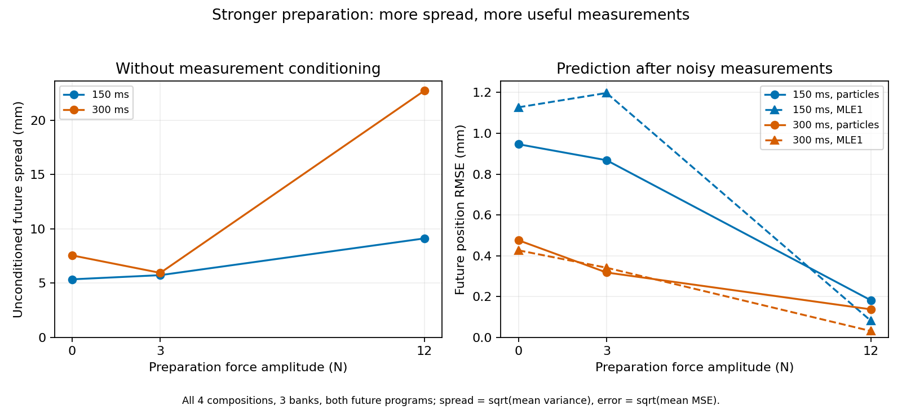

# Physics Transfer Benchmarks

Simulation experiments on friction, compliance, and material memory. The project includes separate and joint prediction models, analytical references, controlled state-estimation experiments, and evaluation tools.


[Tool guide](docs/TOOLS.md): commands, inputs, outputs, and operating sequence.

## Initialize

The core tests run on CPU with Python 3.11; Isaac Sim is not required for this first check.

```bash
git clone https://github.com/SpookyGeista/physics-transfer-benchmarks.git
cd physics-transfer-benchmarks
python3.11 -m venv .venv
source .venv/bin/activate
python -m pip install -r requirements-offline.txt
python -m pip install --no-deps -e .
python -m pytest -q tests
```

The tests cover model structure, force integration, split separation, and evaluation logic.

## Inspect the saved results

[Overall metrics](evidence/overall_metrics.csv) · [Physical spread](evidence/physical_spread.csv) · [Results by force program](evidence/noisy_by_program.csv)



The initial experiment found no consistent advantage for modular learning. The controlled follow-up uses matched truth and estimation laws; it is a synthetic mechanism study.

## Initialize the simulation pipeline

Use an Isaac Sim 5.1 / Isaac Lab Python environment plus a separate MuJoCo environment. The complete pipeline also uses SciPy, pandas, Matplotlib, and scikit-learn; `configs/requirements-observed.txt` records the original package inventory, rather than a minimal installation lock.

From the repository root:

```bash
export NPT_PYTHON=/path/to/isaac-environment/bin/python
export NPT_MUJOCO=/path/to/mujoco-environment/bin/python
mkdir -p results reports videos
"$NPT_PYTHON" scripts/isaac_smoke.py --headless --device cpu
```

Isaac still requires graphics/GPU access during startup. Once the smoke test passes, start the original experiment pipeline:

```bash
bash scripts/run_all.sh
```

Outputs go to `results/`, `reports/`, and `videos/`. The pipeline resumes existing stages, so use a fresh checkout for a new reproduction. Later studies under `matched_study/` also require calibration banks, protocols, and preflight records that are not included in this export.
